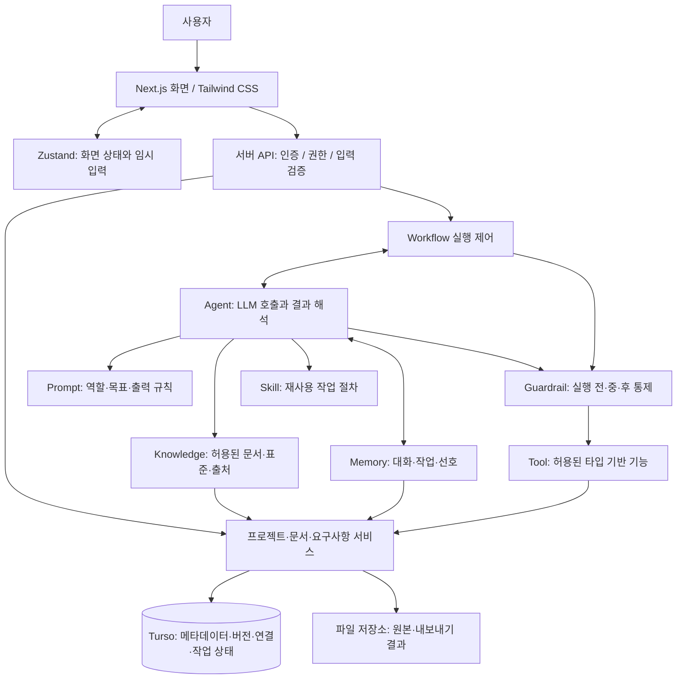

# AI Agent 아키텍처 및 통합 문서관리 퍼블리싱 설계

- 작성일: 2026-11-12 (한국시간, Asia/Seoul)
- 대상: `hams-onedoc`
- 상태: 검토용 설계 초안 — 사용자 검토·수정 후 구현 요청 예정
- 현재 작업: 소스 조사, 설계 문서 작성, `HISTORY.md` 등록만 수행
- 후속 구현 우선순위: 공통 레이아웃과 업무 화면 퍼블리싱 → 인증·데이터 연동 → AI Agent 실행
- 근거: 사용자 요청, 대화에 첨부된 사업 방향성 이미지, 현재 프로젝트 소스 및 `PROMPT.md`

## 1. 목적과 범위

HAMS onedoc을 **AI 기반 프로젝트 문서 통합관리 웹서비스**로 구성한다. 핵심은 문서 초안 생성에 더해 요구사항 ID를 기준으로 기획·설계·변경 이력·납품 산출물을 연결하는 것이다.

현재는 구현 전 분석 단계다. 본 문서에서 제안하는 파일·테이블·API는 생성된 기능이 아니며, 이번 작업에서는 소스, 패키지, 환경 설정, DB를 변경하지 않는다. 실제 화면 퍼블리싱도 사용자 검토 후 별도 구현 요청 시 수행한다.

### 1.1 단계 구분

| 단계 | 포함 범위 | 완료 기준 |
| --- | --- | --- |
| 이번 단계: 설계 | 현재 구조·영향 분석, UI 및 Agent 설계, 검증 계획, 미결정 사항 | 본 문서와 이력 링크 작성, 기존 소스 보존 확인 |
| 1차 구현: 퍼블리싱 | 공통 셸, 대시보드, 팀공유, 개인·프로젝트·관리자 설정, 프로젝트 작업 화면, 테마, 반응형, 샘플 상호작용 | 실제 API 없이 화면 이동과 주요 작업 흐름 검토 가능 |
| 2차 구현: 업무 데이터 | 인증, 서버 권한 검사, Turso 저장, 파일 저장소, 문서·요구사항·버전·공유 연동 | 프로젝트별 접근 분리와 CRUD 검증 |
| 3차 구현: AI 실행 | 문서 파싱, Knowledge 검색, Skill·Workflow 실행, Guardrail, 결과 검토·저장 | RFP에서 출처를 포함한 기능 명세 초안 생성 및 검토 가능 |
| 후속 확장 | WBS·아키텍처·화면·DB 설계, 변경 영향 고도화, 산출물 내보내기 | 요구사항과 산출물 간 추적성 유지 |

모든 단계를 한 번에 구현하는 지시로 해석하지 않는다. 특히 1차에서는 DB 연결, 실제 문서 업로드·파싱, LLM 호출, 실제 로그인·로그아웃, 외부 공유, 파일 생성은 수행하지 않는다.

## 2. 요구사항 분석

### 2.1 사업 방향을 화면과 기능으로 전환

첨부 이미지는 사업 방향 설명 자료다. 소개 슬라이드를 그대로 웹 화면으로 복제하기보다, 그 안의 가치와 업무 흐름을 서비스 화면으로 전환하는 것을 제안한다. 이미지 파일은 프로젝트 `public/`에서 확인되지 않았으므로 실제 자산 경로를 가정하지 않는다.

| 이미지의 문제·가치 | 서비스 설계 반영 | 1차 화면 표현 |
| --- | --- | --- |
| 문서 작성·반복 수정 부담 | RFP 기반 요구사항 추출과 문서 초안 생성 | RFP 등록 진입점, 문서 생성 작업 카드 |
| 문서·협업·화면설계·스프레드시트 도구 분산 | 프로젝트를 중심으로 문서와 산출물 통합 | 프로젝트 목록, 프로젝트별 작업 공간 |
| 산출물 간 내용 불일치 | 요구사항 ID와 근거·산출물 연결 | 요구사항 ↔ 기능 ↔ 설계서 연결 표시 |
| 요구사항 변경 시 수동 추적 | 변경 내역, 영향 후보, 재검토 상태 | 변경 영향 패널, 검토 필요 배지 |
| 팀 협업과 권한 관리 | 소속·프로젝트·문서 단위 접근 제어 | 팀공유 목록, 멤버·역할 화면 |
| 최종 납품 준비 부담 | 산출물 상태·버전·검토 여부 집계 | 산출물 목록과 준비 상태 |

이미지의 시장 규모·성장률·주당 절감 시간 등은 이번 작업에서 사실 검증한 값이 아니다. 제품 내 실제 성과 지표나 확정된 절감 효과로 사용하지 않는다. 대시보드의 수치는 별도의 샘플 업무 데이터로 구성하고 ‘샘플 데이터’임을 표시한다.

### 2.2 요구사항과 수용 기준

| ID | 요구사항 | 단계 / 수용 기준 |
| --- | --- | --- |
| REQ-UI-001 | 좌측 메뉴, 우측 본문, 푸터로 레이아웃 분리 | 1차 / 각 영역이 겹치지 않고 화면 높이에 맞게 표시 |
| REQ-UI-002 | 좌측 상단 로고, 대시보드·팀공유·개인설정·프로젝트설정·관리자설정·로그아웃 | 1차 / 지정 메뉴 모두 표시, 현재 위치 식별 가능 |
| REQ-UI-003 | 우측 상단 헤더와 본문 분리, 로고 영역과 크기 정렬 | 1차 / 로고와 헤더의 높이가 동일; 너비 해석은 5.1 참고 |
| REQ-UI-004 | 헤더 좌측 화면 네비게이터, 우측 라이트·다크 전환 | 1차 / 경로와 제목 동기화, 두 테마 전환 및 새로고침 유지 |
| REQ-UI-005 | 사업 방향을 반영한 통합 문서관리 UI | 1차 / RFP부터 산출물까지 단계·연결·변경 상태 확인 |
| REQ-UI-006 | 모바일·키보드·상태 화면 지원 | 1차 / 메뉴 드로어, 포커스, 빈 목록·로딩·오류·권한 없음 예시 |
| REQ-TECH-001 | React·Next.js·TypeScript, Zustand, Tailwind CSS, Turso | 1차 UI / DB는 2차; 기존 의존성을 우선 활용 |
| REQ-AG-001 | Prompt·Knowledge·Skill·Tool·Memory·Workflow·Guardrail 역할 분리 | 3차 / 구성별 입력·출력·책임과 버전 추적 |
| REQ-AG-002 | 요구사항 분석과 기능 명세 생성 | 3차 / 기능 ID·이름·설명·관련 요구사항 ID 및 근거 제공 |
| REQ-DATA-001 | 요구사항 ID 중심 연결·문서 버전·변경 이력 | 2차 / 서버 ID 발급, 관계 무결성, 과거 버전 재현 |
| REQ-SEC-001 | 프로젝트 격리·권한·개인정보·출력 정합성 검증 | 2~3차 / 서버에서 조회·검색·Tool 실행·저장 권한 검증 |
| REQ-MEM-001 | 대화·작업 상태와 사용자 선호 분리 | 2~3차 / 저장 범위·삭제 기준·우선순위 명확화 |
| REQ-DOC-001 | 날짜별 작업명 문서 및 이력 링크, 문서만 변경 | 이번 단계 / 2026-11-12 폴더 사용, 소스·DB 변경 없음 |

## 3. 현재 구조와 확인 근거

### 3.1 실제 파일 구성

```text
hams-onedoc/
├─ app/
│  ├─ layout.tsx
│  ├─ page.tsx
│  ├─ globals.css
│  └─ favicon.ico
├─ public/                  # next/vercel/file/globe/window SVG
├─ package.json
├─ pnpm-lock.yaml
├─ pnpm-workspace.yaml
├─ next.config.ts
├─ tsconfig.json
├─ eslint.config.mjs
├─ README.md
└─ PROMPT.md
```

확인 시점에 `components/`, `stores/`, `lib/`, `app/api/`, DB 스키마·마이그레이션, 업무별 라우트는 없다. `docs/`와 `HISTORY.md`도 없어 이번 문서 작업에서 신규 생성한다. 프로젝트 및 상위 경로에서 적용되는 `AGENTS.md`는 발견하지 못했다. 작업 루트와 대상 디렉터리에 Git 저장소가 없어 Git diff 대신 파일 해시 비교로 기존 파일 보존을 확인한다.

| 확인 파일 | 현재 상태 | 변경 영향 |
| --- | --- | --- |
| `app/page.tsx` | Next.js 로고, 시작 안내, 배포·문서 링크의 기본 페이지 | 대시보드로 전환할 대상; 기존 업무 동작 없음 |
| `app/layout.tsx` | `lang="en"`, 기본 메타데이터, Geist/Geist Mono, 세로 flex body | 한국어·브랜드 메타데이터, Provider 및 공통 레이아웃 연결 필요 |
| `app/globals.css` | Tailwind import, 흰색/검정 토큰, OS 다크 미디어쿼리, Arial body | 명시적 테마 선택, 업무용 토큰·폰트 정책 정비 필요 |
| `next.config.ts` | `agentFeedback`, `cacheComponents`, `partialPrefetching`, Turbopack CSS 로더 설정 | 현 설정을 유지하는 출발점; 사용자별 업무 데이터 캐시 경계는 후속 검증 필요 |
| `package.json` | Next `16.4.2`, React/React DOM `19.3.0`, Zustand `^5.0.15`, Tailwind `^4`, `@libsql/client` `^0.18.0` 선언 | 요청 기술의 기본 의존성은 등록됨; 선언만으로 연동 완료를 의미하지 않음 |
| `package.json` 기타 | MUI·Emotion, TanStack Query, BlockNote·Tiptap·OnlyOffice, S3 SDK, `unpdf`, Mermaid 등 등록 | 여러 대안이 함께 존재하므로 UI·에디터·저장소 채택 여부 구분 필요 |
| `tsconfig.json` | strict TypeScript, 루트 기준 `@/*` 별칭 | 신규 파일도 루트 `app/`, `components/`, `lib/` 구조 사용 가능 |
| `README.md` | create-next-app 기본 안내 | 후속 구현 시 실제 실행·구성 안내로 갱신할 후보 |
| `PROMPT.md` | Agent 개념·문서 작성 및 구현 절차 | 요구사항 참고 자료이며 실행 엔진 또는 Agent Prompt 레지스트리는 아님 |

버전은 로컬 `package.json`의 선언값이다. 이번 단계에서 설치·업그레이드·빌드 호환성 검증은 수행하지 않는다. DB 연결 코드나 환경 파일은 대상 트리에서 확인되지 않았으며, 원격 DB의 존재·스키마·실데이터는 조사하지 않았다.

### 3.2 현재 구조에서의 설계 판단

- 기존 업무 화면을 개편하는 수준보다, 기본 프로젝트 위에 업무 셸과 도메인 구조를 새로 구성하는 작업에 가깝다.
- Zustand와 Turso 클라이언트는 등록되어 있으나 Store·Repository·인증·Agent 실행기는 신규 설계 대상이다.
- 1차 UI는 Tailwind CSS와 `lucide-react`를 중심으로 통일한다. 등록된 MUI·Emotion을 섞어 신규 공통 스타일을 이중으로 구성하지 않는 안을 제안한다. 의존성 삭제는 별도 판단이다.
- 문서 편집기는 1차에서 읽기 전용 미리보기로 시작한다. 여러 에디터를 동시에 도입하지 않으며, 실제 편집기 선택은 미결정 사항으로 남긴다.
- 다른 `hams-*` 서비스의 인증·컴포넌트·DB를 자동으로 재사용하거나 변경하지 않는다. 연동 필요 시 계약과 권한 범위를 별도로 검토한다.

## 4. 목표 구성과 책임 경계



Workflow가 상태·순서·분기를 관리하고, Agent가 그 안에서 해석·분류·초안 생성을 수행한다. Guardrail은 진입 시뿐 아니라 모델 입력 구성, Tool 호출, 결과 검증, 저장 시점에 각각 적용한다. 위 도식의 연결은 논리적 책임이며, Guardrail을 한 번 호출하면 전체 통제가 끝나는 구조로 구현하지 않는다.

Next.js의 서버·클라이언트 분리는 공식 문서의 기준을 따른다. UI 상호작용은 Client Component에 두고 DB·비밀키 접근은 서버 영역에 둔다. 전체 루트 레이아웃을 일괄 Client Component로 만들 필요는 없다. [Next.js Server and Client Components](https://nextjs.org/docs/app/getting-started/server-and-client-components)

| 계층 | 담당 | 담당하지 않는 일 |
| --- | --- | --- |
| 화면 | 표시, 입력, 검토, 로컬 필터, 실행 상태 조회 | DB 직접 연결, API 키 보관, 권한 최종 결정 |
| Zustand | 테마·메뉴·프로젝트 문맥·미저장 입력·화면 선택 상태 | 인증 증명, 영구 업무 데이터의 유일한 원장, 서버 작업 실행 |
| 서버 서비스 | 권한 확인, 서버 ID 발급, 버전·관계 검사, 저장 트랜잭션 | 자연어 이해를 고정 규칙만으로 대체 |
| Agent | 자연어 해석, 기능/비기능 분류, 중복 후보, 문서 초안·설명 | 고유 ID 임의 확정, 임의 SQL 실행, 권한 확대 |
| Workflow | 단계 실행, 재시도·중단·재개, 검토 대기, 실행 이력 | Skill 내부 전문 지침을 모두 복제 |
| Repository·저장소 | 범위가 제한된 데이터 접근과 파일 보관 | 모델이 전달한 tenant/project 범위를 무검증 신뢰 |

## 5. 화면 퍼블리싱 설계

### 5.1 공통 레이아웃

```text
┌──────────────────┬──────────────────────────────────────────────┐
│ HAMS onedoc 로고  │ 화면 네비게이터                 라이트/다크  │ ← 동일 높이
├──────────────────┼──────────────────────────────────────────────┤
│ 대시보드          │ 화면 제목 / 프로젝트 문맥 / 주요 액션       │
│ 팀공유            │                                              │
│ 개인설정          │ 업무 본문                                    │
│ 프로젝트설정      │ 카드 / 단계 진행 / 표 / 문서 미리보기        │
│ 관리자설정        │                                              │
│                  ├──────────────────────────────────────────────┤
│ 로그아웃          │ Footer: 서비스명 / 버전 등                   │
└──────────────────┴──────────────────────────────────────────────┘
```

사용자의 ‘헤더는 로고영역과 크기를 같게 한다’는 요구는 **높이를 같게 맞춘다**는 안으로 해석한다. 로고 너비는 사이드바 너비, 헤더 너비는 우측 가용 너비로 둔다. 너비까지 동일해야 한다면 레이아웃 재합의가 필요하다.

| 항목 | 제안값·동작 |
| --- | --- |
| 데스크톱 사이드바 | 240px, 로고는 `HAMS onedoc` 텍스트형 임시 로고; 정식 로고 확정 시 교체 |
| 로고·헤더 | 공통 `--app-header-height: 64px`; 분리된 숫자를 중복 정의하지 않음 |
| 전체 배치 | 데스크톱 Grid 2열, 우측은 헤더·본문·푸터 3행; `min-width: 0`, `min-height: 0` 적용 |
| 스크롤 | 데스크톱 본문 독립 세로 스크롤, 사이드바 메뉴가 길면 별도 스크롤; 본문에 `100vh`를 중복 부여하지 않음 |
| Footer | 우측 열 하단 배치안, 기본 높이 40px·내용에 따라 확장; 본문을 덮는 overlay 형태 금지 |
| 콘텐츠 여백 | 데스크톱 24px, 모바일 16px 제안; 표·상세 화면은 가용 폭 사용 |
| 로그아웃 | 메뉴 하단 버튼, 긴 화면에서도 접근 가능; 1차는 데모 안내만 표시 |
| 화면 네비게이터 | ‘대시보드 / 프로젝트명 / 요구사항’ 형태 breadcrumb; 마지막 항목은 현재 화면 |
| 테마 | 헤더 우측 2상태 토글, 현재 모드와 다음 전환 동작을 접근 가능한 이름으로 제공 |

Footer를 전체 폭으로 둘지, 우측 열에만 둘지는 검토 항목이다. 본 문서의 기본안은 우측 열이며 모바일은 콘텐츠 흐름 안에 둔다.

### 5.2 메뉴와 라우트

표의 파일·경로는 후속 구현 제안이다. 고정 사이드바에는 요청한 여섯 항목을 유지하고, 프로젝트 업무 기능은 프로젝트 카드에서 진입하는 내부 탭으로 제공한다.

| 메뉴·화면 | 경로 제안 | 주요 구성 | 1차 동작 |
| --- | --- | --- | --- |
| 대시보드 | `/` | 프로젝트 선택, 업무 요약, 생성 흐름, 최근 산출물, 검토 대기 | 샘플 프로젝트 이동, 작업 카드·문서 선택 |
| 팀공유 | `/team` | 공유된 문서·프로젝트, 공유자, 접근 역할, 최근 변경 | 검색·필터·미리보기; 실제 초대·공유는 준비 중 안내 |
| 개인설정 | `/settings/profile` | 표시 이름, 테마, 기본 문서 템플릿, 선호 저장 안내 | 테마는 유지, 나머지 임시 입력·초기화; 영구 저장 없음 표시 |
| 프로젝트설정 | `/settings/project` | 프로젝트 선택, 기본 정보, 요구사항 ID 규칙, 멤버 역할, 문서 템플릿 | 프로젝트 전환 및 임시 변경; 샘플 권한 편집임을 안내 |
| 관리자설정 | `/settings/admin` | 사용자·역할 요약, Agent 정책, Prompt·Skill 버전, 실행·감사 로그 예시 | 목록·상세 시안, 서버 설정 변경 없음 |
| 로그아웃 | 라우트 없는 버튼 | 후속 인증 세션 종료 진입점 | ‘데모 화면에서는 실제 세션이 종료되지 않습니다’ 안내 |
| 프로젝트 작업 공간 | `/projects/[projectId]` | 개요, RFP, 요구사항, 문서 생성, 변경 영향, 산출물 탭 | 내부 탭·문서·관련 요구사항 탐색 |

프로젝트설정은 선택 프로젝트를 URL 검색 매개변수 `projectId`에 반영한다. 프로젝트를 선택하지 않았으면 선택 안내를 표시하며, 임의의 첫 프로젝트를 몰래 편집 대상으로 삼지 않는다. 작업 공간의 `projectId`는 경로가 기준이다. Store와 URL이 다르면 URL을 우선한다.

프로젝트 내 탭은 1차에 `?tab=requirements` 같은 허용된 탭 값으로 표현하고, 새로고침·직접 링크·뒤로가기에 동일한 위치를 복원한다. 잘못된 프로젝트는 찾을 수 없음 화면으로, 잘못된 탭은 개요로 처리한다. 서버 연동 후에는 타 프로젝트 정보 노출 없이 권한 없음/찾을 수 없음 정책을 적용한다.

### 5.3 대시보드와 프로젝트 작업 화면

1. 상단에 ‘프로젝트 문서를 하나의 흐름으로 관리합니다’라는 업무 메시지와 선택 프로젝트를 표시한다. 주요 액션은 ‘RFP로 시작하기’, ‘문서 생성’으로 둔다.
2. 요약 카드에는 진행 프로젝트, 문서, 검토 필요 항목, 최근 변경 건수를 표시한다. 샘플 수치는 동일한 fixture에서 집계하여 카드와 목록이 일치하도록 한다.
3. 업무 흐름은 `RFP 분석 → 요구사항 구조화 → 설계서 초안 생성 → 변경 영향·버전 관리 → 산출물 통합관리`로 표시한다. 설계서에는 WBS·아키텍처·화면·기능·DB 명세가 포함됨을 안내한다.
4. 프로젝트 카드는 프로젝트명·진행 단계·최근 수정·검토 대기 수를 제공한다. 최근 산출물 표는 문서명·종류·버전·상태·수정자를 제공한다.
5. 변경 영향 패널은 `REQ-001 변경 → FUNC-001 및 화면설계서 검토 필요`처럼 연결 관계를 보여준다. 실제 분석 완료처럼 표현하지 않고 샘플 관계임을 표시한다.

| 작업 공간 탭 | 콘텐츠 | 대표 상호작용 |
| --- | --- | --- |
| 개요 | 문서 상태, 다음 작업, 최근 활동 | 관련 탭으로 이동 |
| RFP | 원본 문서명, 문서 버전, 페이지·절 근거 예시 | 샘플 RFP 선택·미리보기; 실제 업로드는 준비 중 |
| 요구사항 | ID, 기능/비기능, 내용, 출처, 연결 산출물 | 유형 필터, 검색, 상세 패널 |
| 문서 생성 | 산출물 종류, 템플릿, 입력 요구사항, 실행 단계 | 샘플 결과 보기; 실제 모델 실행 없음 |
| 변경 영향 | 변경 전후 요약, 연결된 기능·문서, 검토 상태 | 영향 후보 상세와 관련 문서 이동 |
| 산출물 | 기능 명세·WBS·아키텍처·화면·DB 설계 목록, 버전 | 읽기 전용 상세, 근거 요구사항 이동; 실제 다운로드는 준비 중 |

1차에서는 페이지 전체에 ‘샘플 데이터’ 표시를 제공한다. 실제 미구현 동작은 버튼 옆 상태 또는 클릭 안내로 전달한다. 성공 토스트·업로드 완료·저장 완료로 실제 처리를 오인하게 하지 않는다. 비활성 버튼만 두는 경우에도 사유를 볼 수 있게 한다.

### 5.4 시각 스타일, 테마, 반응형

- 이미지의 마젠타·분홍색을 브랜드 포인트로 사용한다. 업무 화면 배경은 중립색 위주로 하여 장시간 표·문서 확인에 적합하게 구성한다. 아래 값은 이미지에서 추출한 확정 색상이 아닌 제안값이다.
- Tailwind를 기본 스타일 수단으로 사용하고 색상·간격·테두리·헤더 높이를 CSS 변수로 공유한다. 성공·경고·오류는 텍스트와 아이콘도 함께 사용한다.
- 본문 한국어 가독성을 우선한다. 기본 시스템 한글 폰트 스택을 제안하며, 유료·외부 폰트 도입은 별도 결정한다. 루트 `lang`은 후속 구현 시 `ko`로 변경한다.

| 토큰 | 라이트 제안 | 다크 제안 |
| --- | --- | --- |
| 배경 / 표면 | `#F8FAFC` / `#FFFFFF` | `#0F172A` / `#111827` |
| 주요 텍스트 / 보조 텍스트 | `#0F172A` / `#475569` | `#F8FAFC` / `#CBD5E1` |
| 테두리 | `#E2E8F0` | `#334155` |
| 브랜드 포인트 | `#BE124B` | `#F472B6` |

포인트색 위 텍스트는 테마에 맞게 정하고 실제 대비를 측정한다. 흰색 텍스트를 모든 분홍 배경에 공통 적용하지 않는다. 기본 텍스트 대비 4.5:1 이상을 검증 목표로 둔다.

현재 CSS는 OS 설정 기반이다. 명시적 토글을 지원하려면 Tailwind의 `dark` 변형을 루트 선택자에 연결하고 기존 미디어쿼리와 충돌하지 않게 정리해야 한다. 수동 선택자 방식은 [Tailwind CSS Dark mode](https://tailwindcss.com/docs/dark-mode)를 참고한다.

제안 상태는 `light | dark` 두 가지다. 저장된 값이 없으면 라이트로 시작하고 OS 모드 추종은 별도 기능으로 남긴다. 1차는 민감하지 않은 테마 값만 브라우저에 보관한다. 첫 화면 페인트 전 동일 값을 루트에 반영하고, Store 재수화와 초기 마크업이 일치하도록 초기화 순서를 설계한다. 저장소 접근이 실패해도 라이트와 토글이 동작해야 한다. 후속 인증 연동 시 계정 선호와 브라우저 선호의 우선순위를 확정한다.

| 화면 폭 제안 | 동작 |
| --- | --- |
| 1024px 이상 | 사이드바 240px, 우측 고정 헤더 높이, 카드 3~4열 |
| 768~1023px | 사이드바 대신 메뉴 버튼·드로어, 카드 2열, breadcrumb 축약 |
| 767px 이하 | 카드 1열, 메뉴 드로어, 액션 줄바꿈, 푸터 자연 배치 |

모바일 메뉴 버튼은 헤더 좌측 breadcrumb 앞에 둔다. 드로어는 열 때 포커스를 이동하고 닫을 때 버튼으로 돌려주며, Escape와 배경 클릭을 지원한다. 표가 넓으면 표 컨테이너만 가로 스크롤한다. 페이지 전체의 불필요한 가로 스크롤과 고정 영역 겹침을 막는다. 내비게이션에는 현재 메뉴·현재 경로 속성을 제공하고 테마·아이콘 버튼에 이름을 부여한다.

### 5.5 공통 상태

| 상태 | 표시·복구 동작 |
| --- | --- |
| 로딩 | 영역별 skeleton과 로딩 설명; 레이아웃 높이 급변 최소화 |
| 빈 데이터 | ‘등록된 프로젝트가 없습니다’ 등 원인에 맞는 설명과 시작 액션 |
| 검색 결과 없음 | 검색 조건 안내와 필터 초기화 |
| 오류 | 사용자용 오류 설명·재시도; 내부 키·문서 원문 노출 금지 |
| 권한 없음 | 접근 불가와 복귀 경로; 1차는 시안임을 표시 |
| Agent 실행·검토 대기 | 현재 단계·상태·다음 행동; 1차는 선택 가능한 샘플 상태로 표현 |

샘플 화면 상태는 fixture/데모 데이터 계층에서 바꿀 수 있게 하며, 개발용 상태 선택 UI를 실제 제품의 일반 업무 흐름에 상시 노출하지 않는다.

## 6. Zustand 및 데이터 경계

| 상태 | 위치 제안 | 영속화·초기화 |
| --- | --- | --- |
| 테마 | `ui-store` | 라이트·다크 값만 브라우저 저장 |
| 모바일 메뉴, 펼침 상태 | `ui-store` | 메모리; 화면 이동 시 메뉴 닫기 |
| 현재 프로젝트 표시 문맥 | `workspace-store` | URL에서 초기화; 프로젝트 전환 시 관련 임시 상태 초기화 |
| 검색·필터·탭 | 로컬 state 또는 URL | 공유·뒤로가기 복원이 필요한 값은 URL 우선 |
| 미저장 문서 생성 옵션·설정 입력 | 해당 화면 또는 `workspace-store` | 1차 메모리만; 이동 시 변경 폐기 안내 |
| 문서·요구사항·멤버·버전 | 1차 fixture, 2차 서버 Repository | Zustand에 원장 복제하지 않음 |
| 실행 상태·이벤트 | 서버 작업 저장소, 클라이언트는 조회 결과 | 브라우저를 닫아도 서버 작업 수명과 분리 |

Store는 Provider 경계에서 생성하고 서버 프로세스의 변경 가능한 전역 인스턴스로 사용자별 상태를 공유하지 않는 안을 적용한다. 서버 렌더링과 클라이언트 초기 상태가 일치해야 한다. [Zustand Setup with Next.js](https://zustand.docs.pmnd.rs/learn/guides/nextjs)

이미 등록된 TanStack Query는 2차 서버 데이터 조회·무효화에 사용할지 결정한다. 도입하면 서버 데이터 캐시는 Query, UI 상태는 Zustand로 역할을 나눈다. 1차 퍼블리싱을 위해 API 캐시 계층을 먼저 구축할 필요는 없다. 인증 정보, 원문 문서, 장기 Memory, 비밀키를 Zustand persist에 저장하지 않는다.

## 7. AI Agent 상세 설계 — 후속 구현

### 7.1 일곱 구성요소

| 구성요소 | 의미·책임 | 입력 → 출력 | 관리 방식 제안 |
| --- | --- | --- | --- |
| Prompt | 행동 지시: 역할·목표·출력 규칙 | 작업·템플릿·허용된 문맥 → 버전 고정 실행 지시 | Agent별 버전, 출력 스키마 버전 |
| Knowledge | 판단 근거: 표준·업무 규칙·기존 문서 | 인증된 프로젝트 범위·질의 → 문서 버전·위치 포함 근거 | 문서 메타데이터, 청크, 검색; 필요 시 벡터 검색 추가 |
| Skill | 개별 전문 작업 방법 | 문서/요구사항·설정 → 구조화된 분석/초안 | 지침·예제·템플릿·허용 Tool·입출력 계약을 묶어 버전 관리 |
| Tool | 실제 실행 수단 | 검증된 타입 인자·서버 실행 문맥 → 파싱·조회·저장·파일 결과 | 서버 레지스트리와 허용 목록; 범용 SQL·셸 노출 금지 |
| Memory | 과거 정보 재사용 | 사용자·프로젝트·작업 문맥 → 관련 대화·체크포인트·선호 | 단기/장기 분리, 범위·보존·삭제 정책 |
| Workflow | 여러 작업의 순서·분기·복구 | 요청·현재 상태 → 다음 단계·검토 대기·종료 | 상태 머신, 단계별 결과·시도·이벤트 |
| Guardrail | 안전·품질 통제 | 입력·검색 결과·Tool 인자·모델 출력 → 허용/차단/재검토 | 권한·개인정보·스키마·근거·비용 정책 |

**Skill과 Workflow의 구분:** `requirement-analysis` Skill은 입력 문서 구조 분석, 기능/비기능 분류, 중복 후보 식별, 표준 출력이라는 전문 방법을 제공한다. Workflow는 업로드된 문서를 이 Skill에 전달하고, 검증 결과에 따라 재분석·사용자 검토·저장 단계로 이동시킨다. ID 생성 절차는 Skill이 서버 도구를 이용하도록 지시할 수 있지만 실제 ID 발급은 프로그램이 담당한다.

### 7.2 Prompt·Skill·Tool 예시

- Prompt 역할: 요구사항 분석 전문가. 목표: 기능 요구사항을 추출하고 기능 명세 초안을 작성한다. 출력 필수 항목: 기능 ID, 기능명, 기능 설명, 관련 요구사항 ID. 추가로 원문 근거, 확인 필요 사항을 제공한다.
- `requirement-analysis`: 원문 구조·근거 추출, 기능/비기능 분류, 중복·모호성 후보, 후보 요구사항 목록을 반환한다. 중복 후보를 자동 삭제하거나 누락된 내용을 임의 확정하지 않는다.
- `functional-specification`: 검토된 요구사항으로 기능 초안을 만들고 입력 요구사항과 연결한다. 필수 연결이 없으면 미연결 사유와 검토 경고를 반환한다.
- `change-impact-analysis`: 기존 연결을 따라 영향 후보를 계산한 결과에 자연어 설명을 보완한다. LLM 설명만으로 영향이 없다고 확정하지 않는다.
- 이후 WBS·화면·아키텍처·DB 설계 Skill을 같은 계약으로 확장한다.

| Tool 예시 | 실제 처리 | 서버 검증 |
| --- | --- | --- |
| `parseDocument(documentVersionId)` | 허용된 원본에서 텍스트·페이지/절 위치 추출 | 파일 접근, 형식·크기, 파싱 제한 |
| `searchKnowledge(query, filters)` | 허용 문서·표준 검색 및 출처 반환 | tenant/project/문서 ACL을 검색 전에 적용 |
| `allocateRequirementIds(candidateIds)` | 후보에 안정적인 요구사항 ID 부여 | 작업·후보 매핑, 유일성, 재시도 시 동일 매핑 |
| `saveSpecification(draft, expectedVersion)` | 기능·관계·문서 버전을 원자적으로 저장 | 구조·근거·권한·낙관적 잠금·멱등성 |
| `generateExport(documentVersionId, format)` | 확정 버전으로 파일 생성 | 접근 범위, 지원 형식, 다운로드 만료 정책 |

tenant, 사용자, 실행 권한은 서버가 인증된 세션과 작업 레코드에서 주입한다. 모델이 인자로 넘긴 사용자 ID나 프로젝트 ID를 권한 근거로 삼지 않는다. 문서 파서가 DOCX까지 지원하는지, 파일 생성기가 Excel·Word를 지원하는지는 별도 검증 대상이며 현재 의존성 등록으로 완료를 가정하지 않는다.

### 7.3 예시 Workflow: RFP → 기능 명세서

| 순서 | 처리 | 주체·결과 |
| --- | --- | --- |
| 1 | 요청·프로젝트·파일 버전·템플릿·권한 검증 | 서버 Guardrail, 실행 요청 스냅샷 고정 |
| 2 | 원본 파싱·구조화 및 출처 위치 보존 | Document Parser Tool, 파싱 결과·오류 |
| 3 | 프로젝트 표준·업무 규칙 검색 | Knowledge, 허용된 근거 묶음 |
| 4 | 기능/비기능 분류·중복·모호성 후보 추출 | requirement-analysis Skill + LLM |
| 5 | 구조·근거 검증, ID 부여, 후보 초안 보관 | 서버 로직, 안정적인 ID와 검토 대기 목록 |
| 6 | 요구사항 검토·보완·선택 | 사용자 검토; 누락·충돌 해결 후 다음 단계 |
| 7 | 선택 요구사항 기반 기능 명세 초안 생성 | functional-specification Skill + LLM |
| 8 | 필수 필드·관계·출처·누락 정합성 검증 | Guardrail, 통과/재생성/검토 필요 |
| 9 | 결과 미리보기·수정·확정 | 사용자, 검토된 문서 버전 |
| 10 | 권한·원본 버전 재확인 후 저장 | 서비스 트랜잭션, 버전·연결·감사 기록 |

모델은 후보를 반환하며 서버가 최종 식별자를 확정한다. 생성된 초안 보관과 업무상 승인·확정은 별개다. 문서 상태는 `draft → in_review → approved`처럼 관리하고, 실행 작업의 `completed`만으로 승인 상태를 부여하지 않는다.

### 7.4 실행 상태·재시도·장기 작업

- 실행 상태 제안: `queued → running → waiting_review → running → completed`. 단계별 `stage`를 별도로 두며 실패·취소는 `failed`, `cancelled`로 기록한다.
- 사용자 검토 대기 후에는 승인된 단계부터 재개한다. 검토 중 원본이나 요구사항이 변경되면 이전 스냅샷과 차이를 확인하고 재실행 또는 명시적 재검토를 요구한다.
- 파싱·LLM 호출은 짧은 HTTP 요청 수명에 의존하지 않게 작업 실행기/Worker로 분리한다. Queue·Worker 제품 및 배포 환경은 미정이다. 응답 후 비동기 함수를 호출하는 것만으로 작업 내구성을 보장하지 않는다.
- 실행기에 단계 체크포인트, 시도 횟수, lease/heartbeat, 제한된 재시도, 취소 요청을 둔다. lease 만료 작업을 복구하더라도 이미 처리한 저장을 반복하지 않게 한다.
- 멱등 키는 프로젝트·요청·단계 기준으로 관리한다. 저장 단계에는 유일 제약을 적용하고, LLM은 적어도 한 번 호출될 수 있음을 고려하여 중복 초안·중복 과금을 관찰한다.
- 외부 요청의 일시 오류는 횟수·시간·토큰 한도 내 재시도한다. 권한·입력·근거 오류는 자동 반복 대신 사용자에게 수정 경로를 제공한다.
- 초기 상태 전달은 작업 상태 polling을 제안하고 SSE는 필요 시 추가한다. 브라우저 재접속 시 `runId`로 현재 상태와 결과를 조회한다. 서버에 남은 확정 결과는 취소만으로 되돌리지 않는다.
- 실행마다 Prompt·Skill·Workflow 버전, 모델 식별자, 원문·Knowledge·템플릿 버전, 입력 해시, 단계 지연, 사용량·오류 코드를 기록한다. 비밀키나 원문 전체를 일반 로그에 남기지 않는다.

### 7.5 Memory 및 Guardrail

Short-term Memory는 현재 대화와 작업 상태다. 재개에 필요한 체크포인트는 서버에 저장하고, 모든 대화 내용을 매번 모델에 전달하지 않는다. Long-term Memory는 사용자가 저장하도록 한 템플릿 선호·문서 작성 규칙 등이며 사용자/프로젝트/조직 범위를 명시한다. 프로젝트 업무 데이터 자체를 Memory라는 별도 원장에 중복 저장하지 않는다.

선호 적용 순서는 **보안 정책 → 이번 요청의 허용된 명시적 선택 → 프로젝트 규칙 → 사용자 기본 선호 → 서비스 기본값**을 제안한다. 선호는 접근 권한을 확대하지 않는다. 저장·수정·삭제·보존 기간과 개인정보 처리 방식은 후속 결정 사항이다.

| 시점 | 통제 |
| --- | --- |
| 요청 전 | 인증·권한, 파일 형식·크기, 개인정보·비밀정보 처리 정책, 실행 한도 |
| 문맥 구성 | 문서·검색 결과를 신뢰하지 않는 데이터로 취급, 문서 내부 명령으로 시스템 지시·Tool 권한을 바꾸지 않음 |
| 실행 중 | 허용 Tool/인자 스키마, 서버 문맥 고정, 시간·토큰·호출 횟수 제한, 외부 전송 범위 |
| 출력 후 | 구조 스키마, ID·관계·출처 존재, 원문에 없는 사실·미확정 항목 표시, 개인정보 출력 검사 |
| 저장·내보내기 | 권한 재검사, 기대 버전 검사, 사용자 검토 상태, 감사 기록, 다운로드 권한 |

출력 검증에 사용할 스키마 라이브러리는 미정이다. 모델이 JSON 형식을 맞췄더라도 의미·근거가 맞는지 별도 검증하며, 실패 결과를 정식 승인 산출물로 저장하지 않는다.

## 8. Turso 및 도메인 데이터 설계 — 후속 구현

### 8.1 저장 원칙

Turso에는 업무 메타데이터·정형 데이터·버전·관계·작업 상태를 두고, PDF/DOCX 원본과 내보내기 파일은 객체 저장소에 두는 안을 제안한다. S3 SDK가 등록되어 있지만 실제 저장소 공급자·버킷·업로드 정책이 선택된 상태는 아니다.

등록된 `@libsql/client`는 원격 libSQL DB를 사용하는 경우의 출발점이다. Turso는 DB 엔진별 SDK가 구분되어 있으므로 후속 구현 전에 실제 사용할 DB 엔진과 SDK 호환성을 확정한다. 이번 단계에서 클라이언트 교체나 DB 생성은 하지 않는다. [Turso TypeScript Quickstart](https://docs.turso.tech/sdk/ts/quickstart)

DB 연결은 서버 전용 모듈에 둔다. 환경 변수명은 `TURSO_DATABASE_URL`, `TURSO_AUTH_TOKEN`을 후보로 사용하고 실제 값은 문서·소스·브라우저 번들에 기록하지 않는다. Repository가 서버 권한 문맥을 받아 모든 조회·변경에 범위를 적용하도록 설계한다.

### 8.2 논리 엔터티 후보

아래는 실제 DB 스키마가 아닌 논리 모델이다. 컬럼·인덱스·외래키·마이그레이션 SQL은 엔진·인증·권한 구조 결정 후 작성한다.

| 그룹 | 엔터티 후보 | 관계·핵심 정보 |
| --- | --- | --- |
| 조직·권한 | `tenants`, `users`, `tenant_members`, `projects`, `project_members` | 조직·프로젝트 소속, 역할, 상태 |
| 사용자 설정 | `user_preferences` | 사용자 기본 템플릿·테마; 프로젝트 규칙과 분리 |
| 문서 | `documents`, `document_versions`, `document_templates` | 문서 종류, 상태, 불변 버전, 객체 키, 해시, 템플릿 버전 |
| 파싱·근거 | `document_chunks`, `knowledge_entries` | 원본 버전, 페이지/절/문단 위치, 추출 상태, 접근 범위 |
| 요구사항 | `requirements`, `requirement_versions` | 안정 ID, 표시 코드, 기능/비기능, 내용, 상태, 변경 버전 |
| 기능 | `functional_specs`, `functional_spec_versions` | 기능 ID·이름·설명과 문서 버전; 요구사항과 다대다 연결 |
| 연결 | `trace_links` | 요구사항·기능·WBS·화면·API·DB 등 대상과 버전 사이 관계, 생성 근거·검토 상태 |
| 변경 | `change_requests`, `change_impacts` | 변경 전후 버전, 영향 후보, 재검토·해결 상태 |
| 공유 | `document_grants` | 문서 단위 제한·공유 범위; 프로젝트 권한 상속 규칙 별도 확정 |
| Agent 설정 | `agent_configs`, `prompt_versions`, `skill_versions`, `workflow_versions` | 실행 계약과 버전; Tools는 서버 코드 레지스트리 중심 |
| Agent 실행 | `agent_runs`, `agent_run_steps`, `agent_run_events` | 고정 입력·검색 근거 목록, 상태, 체크포인트, lease, 시도, 멱등 키 |
| Memory | `agent_sessions`, `agent_messages`, `memory_entries` | 세션 문맥과 장기 선호 분리, 범위·보존·삭제 |
| 감사 | `audit_logs` | 작업자·대상·행동·결과·시각; 민감 원문은 제외 |

### 8.3 ID·버전·추적성 규칙

1. 내부 PK는 서버가 생성하고, 표시 코드 `REQ-001`, `FUNC-001`은 프로젝트 안에서 유일하게 관리한다. 정렬 위치나 LLM 출력으로 발급하지 않는다. 동시 발급은 원자적 증가·유일 제약으로 보호한다.
2. 요구사항과 기능은 다대다다. 연결에 원문 버전·근거 위치를 남겨 기능 설명에서 원문까지 역추적할 수 있어야 한다.
3. 문서·요구사항 수정은 새 버전을 만들고 과거 버전을 덮어쓰지 않는다. 초안 편집도 기대 버전을 검사해 다른 사람의 수정을 조용히 덮어쓰지 않는다.
4. 요구사항 변경 시 연결 그래프를 따라 검토 필요 후보를 만든다. 기존 산출물 전체를 자동 덮어쓰지 않고 재생성 후보와 사용자 확정을 분리한다.
5. 기능 명세 버전·요구사항 연결·감사 기록은 짧은 트랜잭션으로 처리한다. LLM·파싱·파일 저장 같은 장기 외부 작업을 DB 트랜잭션 안에서 수행하지 않는다.
6. 원본 객체 저장과 DB 저장 사이에는 실패가 발생할 수 있다. `pending/ready/failed` 상태, 재시도와 미참조 객체 정리로 일관성을 회복한다.
7. 조직·프로젝트 범위가 다른 엔터티 연결을 서비스와 DB 제약으로 차단한다. 다형 관계인 `trace_links`의 대상 존재·타입 검증 방식은 실제 스키마 설계 시 확정한다.
8. 서버 시각은 UTC로 저장하고 화면에서 한국시간 등 표시 시간대로 변환한다. 본 문서·이력의 날짜는 사용자 요청에 따라 한국시간을 사용한다.

Knowledge 검색은 우선 프로젝트·버전·키워드 기반 조회부터 설계한다. 벡터 검색은 필요성·청크 크기·임베딩 공급자·저장 위치·권한 필터 가능성을 검토한 뒤 도입한다. Turso를 선택했다는 이유만으로 Vector DB 구축이 완료되었다고 보지 않는다.

## 9. API 및 권한 계약 후보 — 후속 구현

| API 예시 | 책임·응답 |
| --- | --- |
| `GET /api/projects` | 접근 가능한 프로젝트 목록만 반환 |
| `GET /api/projects/:projectId/documents` | 해당 범위 문서·현재 버전·상태 |
| `GET /api/projects/:projectId/requirements` | 유형·상태·검색 조건에 따른 목록·근거 |
| `POST /api/projects/:projectId/agent-runs` | 원문 버전·템플릿·요청·멱등 키 검증, 접수 시 `202`와 `runId` |
| `GET /api/projects/:projectId/agent-runs/:runId` | 상태·단계·검토 요구·결과 링크; 원문 전체 로그 제외 |
| `POST /api/projects/:projectId/agent-runs/:runId/review` | 기대 버전·검토 내용 검증, 승인된 단계 재개 |
| `POST /api/projects/:projectId/agent-runs/:runId/cancel` | 취소 요청 접수, 실제 중단 상태는 작업 조회로 확인 |
| `POST /api/projects/:projectId/specifications` | 검토된 초안 저장, 버전 충돌 시 `409` |

API는 이번에 생성하지 않는다. 실제 파일 구성·필드 스키마·페이지네이션·업로드·내보내기 계약은 2~3차 상세 설계 대상이다. 오류는 사용자 메시지와 `requestId`를 제공하고 입력 오류·인증 실패·접근 불가·충돌·한도 초과를 구분한다.

권한 역할은 조직 관리자, 프로젝트 관리자, 편집자, 조회자를 후보로 둔다. 플랫폼 운영 관리자와 조직 관리자는 별개이며, 플랫폼 운영 권한이 고객 문서 열람 권한을 자동 부여하지 않는 안을 제안한다. 조회자는 문서 열람, 편집자는 허용된 작성·실행, 프로젝트 관리자는 멤버·프로젝트 규칙을 관리한다. 승인·내보내기·문서별 공유 권한은 별도로 결정한다.

메뉴 숨김과 데모 역할 전환은 접근 제어가 아니다. 서버는 API, 검색, 파일 다운로드, Tool 호출마다 동일한 범위를 검사한다. 현재 `cacheComponents` 설정을 고려하여 사용자·조직·프로젝트 데이터가 공용 캐시로 섞이지 않도록 캐시 키·태그·무효화·미캐시 경계를 검증해야 한다.

## 10. 변경 대상 파일 및 영향 범위

### 10.1 이번 문서 작업의 실제 변경

| 파일 | 변경 내용 |
| --- | --- |
| `docs/history/2026-11-12/AI-Agent-아키텍처-및-통합문서관리-퍼블리싱-설계.md` | 본 설계 문서 신규 작성 |
| `HISTORY.md` | 파일이 없어 신규 작성, 본 문서 상대 경로와 작성일 등록 |

기존 소스·`PROMPT.md`·`README.md`·설정·lockfile·DB는 이번 작업의 변경 대상이 아니다.

### 10.2 1차 퍼블리싱의 변경·신규 파일 제안

| 파일·경로 | 구분 | 책임·영향 |
| --- | --- | --- |
| `app/layout.tsx` | 수정 | `ko`, 브랜드 메타데이터, 폰트·Provider 연결; 루트 서버 경계 유지 |
| `app/globals.css` | 수정 | 공통 토큰, 루트 테마 선택자, 페이지 높이·스크롤 정책 |
| `app/page.tsx` | 수정 | 기본 안내를 대시보드 진입 화면으로 교체 |
| `app/(workspace)/layout.tsx` | 신규 | 팀·설정·프로젝트 라우트에 공통 셸 적용 |
| `app/(workspace)/team/page.tsx` | 신규 | 팀공유 화면 |
| `app/(workspace)/settings/{profile,project,admin}/page.tsx` | 신규, 세 파일 | 각 설정 화면; `{...}`는 표기 축약이며 실제 폴더명이 아님 |
| `app/(workspace)/projects/[projectId]/page.tsx` | 신규 | 프로젝트 작업 공간 및 탭 탐색 |
| `components/layout/{app-shell,sidebar,header,footer,breadcrumbs,mobile-nav}.tsx` | 신규 | 공통 레이아웃·메뉴·경로·모바일 동작 |
| `components/providers/app-store-provider.tsx` | 신규 | Store 생성·주입, 초기 상태 경계 |
| `components/ui/{button,card,badge,data-table,empty-state,theme-toggle}.tsx` | 신규 | Tailwind 기반 공통 UI, 상태·접근성 일관화 |
| `components/dashboard/`, `components/project/`, `components/settings/` | 신규 | 도메인별 화면 조합과 샘플 상호작용 |
| `stores/ui-store.ts`, `stores/workspace-store.ts` | 신규 | UI·미저장 입력, 프로젝트 변경 초기화 |
| `lib/navigation.ts`, `lib/types/domain.ts`, `lib/mock/fixtures.ts` | 신규 | 메뉴 정의·도메인 타입·연결된 샘플 데이터 |
| `public/brand/` | 조건부 신규 | 정식 로고 등 확정 자산이 있을 경우에만 |
| `README.md` | 후속 수정 | 실제 퍼블리싱 구조와 실행 안내 반영 |

`/`의 `app/page.tsx`는 유지하고 공통 `AppShell`을 적용한다. `(workspace)/layout.tsx`도 같은 `AppShell`을 사용한다. 루트와 route group에 `/` 페이지를 중복 생성하지 않는다. 화면 간 레이아웃 지속성이 필요하면 검토 후 `/` 페이지를 그룹으로 이동하는 대안으로 통일한다.

`package.json`, `pnpm-lock.yaml`, `next.config.ts`는 기본 변경 대상이 아니다. 실제 구현 중 필수 의존성·호환성 문제가 확인된 경우에만 근거를 남기고 변경한다. 범위 표시 경로의 개별 파일 수는 구현 시 확정하며, 기재한 파일이 현재 존재한다고 해석하지 않는다.

### 10.3 2~3차 확장 파일 제안

| 경로 | 담당 |
| --- | --- |
| `lib/server/auth/`, `lib/server/policies/` | 인증 문맥, 조직·프로젝트·문서 권한 |
| `lib/server/db/client.ts`, `lib/server/repositories/` | 서버 전용 Turso 연결과 범위 제한 데이터 접근 |
| `db/migrations/` | 검토된 논리 모델 기반 버전별 스키마 |
| `lib/server/services/`, `lib/server/storage/` | ID·버전·추적성·파일 저장 계약 |
| `lib/server/agent/{prompts,knowledge,skills,tools,memory,workflows,guardrails}/` | 일곱 구성요소별 모듈 및 계약 |
| `lib/server/agent/runtime/`, `workers/` | 상태·멱등·복구 및 배포 환경에 맞는 Worker 진입점 |
| `app/api/projects/` | 업무·실행 상태·검토 API |

DB는 현 스키마를 확인한 상태가 아니므로 기존 테이블 수정·삭제 계획을 확정할 수 없다. 실제 연동 전 대상 DB와 백업·마이그레이션 전략을 확인하고 별도 구현 범위로 기록한다.

## 11. 검증 방법

### 11.1 이번 문서 단계

- 요청한 요구사항·현재 구조·수정 방향·대상 파일·검증·미결정 사항이 모두 문서에 있는지 확인한다.
- 이력 링크가 `docs/history/2026-11-12/작업명.md`이며 실제 파일로 연결되는지 확인한다.
- 기존 파일의 SHA-256을 작업 전후 비교해 소스·설정·패키지·기존 문서가 보존되었는지 확인한다.
- 쓰기 범위가 본 문서와 `HISTORY.md`뿐인지 확인한다. DB 접속·DDL·DML·마이그레이션은 실행하지 않는다.
- 문서만 변경하므로 이번 단계에서는 개발 서버·빌드·린트·앱 테스트를 실행하지 않는다. 실행 성공을 가정하거나 기재하지 않는다.

### 11.2 1차 퍼블리싱 구현 후

| 검증 항목 | 확인 방법·통과 기준 |
| --- | --- |
| 정적 검증 | 기존 스크립트 `pnpm lint`, `pnpm build`, 필요 시 `pnpm exec tsc --noEmit`; 실패 시 기존/신규 원인 구분 |
| 레이아웃 | 1440·1024·768·390px 폭에서 로고·헤더 높이 일치, 본문·푸터 겹침 없음 |
| 메뉴·경로 | 요청한 여섯 항목, 현재 메뉴·breadcrumb, 직접 링크·새로고침·뒤로가기 일치 |
| 프로젝트 문맥 | 프로젝트 변경 시 탭·문서·임시 입력 혼선 없음, 미선택·잘못된 ID 처리 |
| 테마 | 양 모드 모든 화면, 저장 후 재접속, 첫 화면 깜빡임·hydration 경고·저장소 실패 확인 |
| 업무 흐름 | 대시보드 → 프로젝트 → 요구사항 → 관련 문서 → 변경 영향 탐색 가능 |
| 샘플 무결성 | 카드 집계와 목록 일치, 관계 ID 존재, 실제 저장·AI 실행처럼 보이는 안내 없음 |
| 접근성 | 키보드 메뉴·토글·드로어·닫기, 포커스 복원, 버튼 이름, 텍스트 대비 측정 |
| 공통 상태 | 빈 데이터·검색 없음·로딩·오류·권한 없음 시안에 설명·다음 행동 존재 |
| 화면 자료 | 주요 화면의 라이트·다크 및 모바일 캡처로 사용자 검토 가능 |

### 11.3 데이터·Agent 연동 후

- 다른 조직·프로젝트 ID로 API·검색·Tool·다운로드를 요청해 차단되는지 검증한다. 사용자 전환 후 캐시·Store에 타 사용자의 데이터가 남지 않는지 확인한다.
- 동시 ID 발급·중복 요청·저장 재시도에서 코드 충돌과 중복 문서가 발생하지 않는지 검증한다. 동시 편집 충돌은 `409` 등 명시적 결과로 처리한다.
- 원본 파싱 실패, 모델 지연·오류, 잘못된 구조, 근거 없는 ID, 잘못된 연결, 한도 초과, DB·파일 저장 일부 실패를 주입해 복구·검토 경로를 확인한다.
- 검토 대기 중 입력 변경, Worker 중단·lease 만료·재시작, 취소·재접속에서도 고정 입력·이벤트·최종 버전이 추적되는지 확인한다.
- 문서 내 악의적 지시가 Tool 범위나 시스템 지시를 바꾸지 못하는지, 민감정보가 로그·브라우저·모델 전송에 무단 포함되지 않는지 검증한다.
- 대표 RFP와 검토된 정답 요구사항을 평가 자료로 준비한다. 추출 누락·오분류·중복 후보·출처 정확도·기능 연결 누락·검토자 수정량·처리 시간·비용을 측정하며 허용 기준은 사용자와 확정한다.

## 12. 결정이 필요한 사항

다음 항목은 확정 요구사항이 아닌 검토 지점이다. 기본안은 문서 검토를 위한 제안이며 사용자 결정으로 변경할 수 있다. 이번 문서 작성을 중단하거나 즉시 답변을 요청할 필요는 없다.

| 항목 | 제안 기본안 | 결정 시점·영향 |
| --- | --- | --- |
| 헤더·로고의 ‘같은 크기’ | 높이 64px만 동일 | 1차 전 / 전체 배치 |
| Footer 범위·내용 | 우측 열 하단, 서비스명·버전 | 1차 전 / 셸·모바일 |
| 이미지 반영 수준·브랜드 | 마젠타 포인트의 업무용 대시보드, 임시 텍스트 로고 | 1차 전 / 색상·자산·완성 기준 |
| 퍼블리싱 화면 깊이 | 여섯 메뉴와 프로젝트 탭 기본 시안, 읽기 전용 문서 | 1차 전 / 작업량·상세 편집 제외 범위 |
| 초기 테마·기기 간 동기화 | 라이트 시작, 브라우저 저장; 계정 연동 후 우선순위 확정 | 1~2차 / 첫 렌더·설정 동기화 |
| 인증·조직·권한 | 조직/프로젝트 소속 기반, 기존 인증 연동은 별도 확인 | 2차 전 / 모든 API·데이터 경계 |
| Turso 엔진·SDK·ORM | 실제 DB 유형 확인 후 기존 클라이언트 활용 가능성 우선 검토 | 2차 전 / Repository·마이그레이션 |
| 파일·편집기·내보내기 | 원본은 객체 저장소, 1차 미리보기, 편집기는 하나 선택 | 2차 전 / 저장·버전·도구·라이선스 |
| Agent 모델·실행기 | 공급자 어댑터와 내구성 있는 Worker 경계 | 3차 전 / 비용·지연·배포 |
| 업로드 지원·제한 | PDF 우선 검토; DOCX·OCR·최대 크기·페이지는 미정 | 2~3차 / 파서·품질·처리 시간 |
| 검색·Knowledge 표준 | 범위 제한 문서 검색부터 시작, 벡터 검색은 필요 시 | 3차 전 / 근거·임베딩·저장소 |
| 검토·승인·Memory 정책 | 초안 저장과 승인 분리, 장기 선호는 명시적 저장 | 2~3차 / 권한·UI·보존·삭제 |
| 승인·공유·감사·운영 접근 | 최소 권한, 운영 관리자 고객 문서 자동 접근 없음 | 2차 전 / 역할·감사·지원 |
| 품질·비용 한도 | 대표 문서 평가 후 수치 확정 | 3차 전 / 실행 한도·출시 기준 |

## 13. 후속 구현 시 적용 절차

사용자가 수정했을 수 있으므로 구현 요청 시 본 파일의 최신 내용을 다시 읽는다. 1차 범위와 확정된 결정 사항을 기준으로 공통 셸·테마·샘플 데이터를 먼저 구성하고, 메뉴별 화면과 프로젝트 탐색을 연결한 뒤 11.2의 검증을 수행한다. 후속 DB·Agent 범위를 임의로 포함하지 않는다.

실제 구현 결과와 DB 변경 여부·검증·미완료 항목은 구현 시점의 별도 작업 기록으로 남긴다. 이 문서는 구현 완료 기록이 아니라 변경 방향을 검토하는 설계 기준이다.
